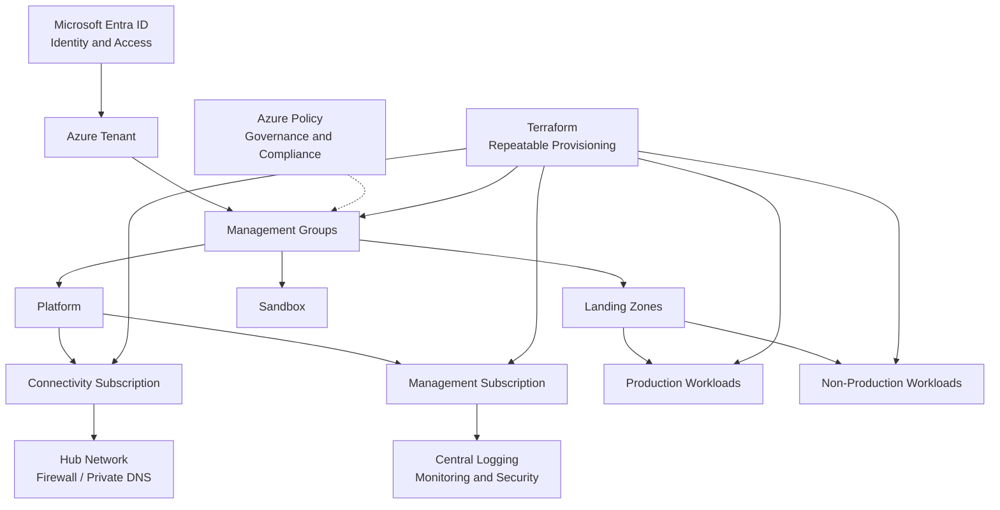

# Enterprise Azure Landing Zone — Greenfield

<p align="center">
  
  
  
  
</p>

## Overview

An enterprise-oriented reference implementation for building a secure, governed, and scalable Microsoft Azure Landing Zone from scratch using Terraform.

The goal is to establish reusable cloud foundations before application teams deploy workloads. The design separates governance, identity, connectivity, management, and workload subscriptions while promoting infrastructure as code and repeatable deployments.

> **Project status:** Initial repository and documentation setup. Architecture and Terraform components will be implemented and validated incrementally. This repository does not yet claim a production-ready landing zone.

## Objectives

- Establish an enterprise management group and subscription hierarchy.
- Apply Azure Policy and governance guardrails.
- Define identity, access control, and least-privilege practices.
- Design centralized connectivity and private networking.
- Establish logging, monitoring, and security-management foundations.
- Automate infrastructure provisioning using reusable Terraform modules.
- Support separate development, test, and production environments.

## Target Architecture



*This is the target logical architecture, not a diagram of already deployed Azure resources. Exact hierarchy, connectivity, and policy assignments will be finalized during implementation.*

## Architecture Workstreams

| Workstream | Scope |
|---|---|
| Management hierarchy | Management groups, subscription placement, environment separation |
| Governance | Azure Policy, policy initiatives, tagging and allowed-region controls |
| Identity and access | Microsoft Entra ID, Azure RBAC, managed identities |
| Connectivity | Hub-and-spoke design, routing, private DNS, private endpoints |
| Management | Centralized diagnostics, Log Analytics, monitoring and alerting |
| Infrastructure as Code | Terraform modules, providers, variables, outputs and remote state |
| CI/CD | Terraform formatting, validation, planning, review and controlled deployment |

## Repository Structure

```text
azure-landing-zone-greenfield/
├── README.md
├── .gitignore
├── LICENSE
├── docs/
│   ├── architecture.md
│   ├── design-decisions.md
│   └── deployment-guide.md
├── architecture/
│   └── landing-zone-flow.mmd
├── terraform/
│   ├── bootstrap/
│   ├── modules/
│   │   ├── management-groups/
│   │   ├── policy/
│   │   ├── identity/
│   │   ├── connectivity/
│   │   └── monitoring/
│   └── environments/
│       ├── dev/
│       ├── test/
│       └── prod/
├── policies/
├── examples/
└── .github/
    └── workflows/
        └── terraform-validate.yml
```

*The structure above is the planned layout. Directories and implementation files will be added as the project progresses.*

## Terraform Engineering Standards

- Pin supported Terraform and provider versions.
- Use reusable modules with explicit inputs and outputs.
- Keep environment-specific configuration separate from module logic.
- Store Terraform state remotely with access controls, locking support, and recovery safeguards.
- Never commit state files, secrets, credentials, or sensitive variable values.
- Run `terraform fmt -check`, `terraform init -backend=false`, and `terraform validate` where applicable.
- Review `terraform plan` before any infrastructure-changing apply.
- Use pull-request review and least-privilege deployment identities.

## Security Principles

1. **Secure by default:** minimize public exposure and enforce private connectivity where required.
2. **Least privilege:** grant only the access necessary for each role and workload.
3. **Governance as code:** manage policy definitions and assignments through version-controlled configuration.
4. **Separation of duties:** separate development, approval, and production deployment permissions.
5. **Auditable changes:** track infrastructure changes through source control and deployment logs.
6. **No committed secrets:** use approved secret-management and workload-identity mechanisms.

## Implementation Roadmap

- [ ] Phase 1 — Document target architecture and design decisions.
- [ ] Phase 2 — Establish Terraform bootstrap and remote state.
- [ ] Phase 3 — Implement management group hierarchy.
- [ ] Phase 4 — Implement Azure Policy and governance controls.
- [ ] Phase 5 — Implement identity and RBAC foundations.
- [ ] Phase 6 — Implement connectivity and private networking.
- [ ] Phase 7 — Implement monitoring and diagnostic settings.
- [ ] Phase 8 — Add CI/CD validation and controlled deployment workflows.
- [ ] Phase 9 — Validate modules, security controls, and environment deployments.

## Validation

Terraform components will be validated incrementally using formatting, initialization, validation, plan review, and applicable policy/security checks.

A successful local validation does not by itself prove that the architecture is deployed or production-ready.

## Disclaimer

This is an engineering reference project for learning, demonstration, and adaptation. Production adoption requires environment-specific security reviews, subscription and networking design, policy approval, cost assessment, and operational readiness checks.

## Author

**Pankaj Kumar Tiwari**  
DevSecOps Architecture | Azure Platform Engineering | Infrastructure as Code

- GitHub: [@pankajdsgithub](https://github.com/pankajdsgithub)

---

*Building secure, governed, reusable, and automated cloud foundations.*
