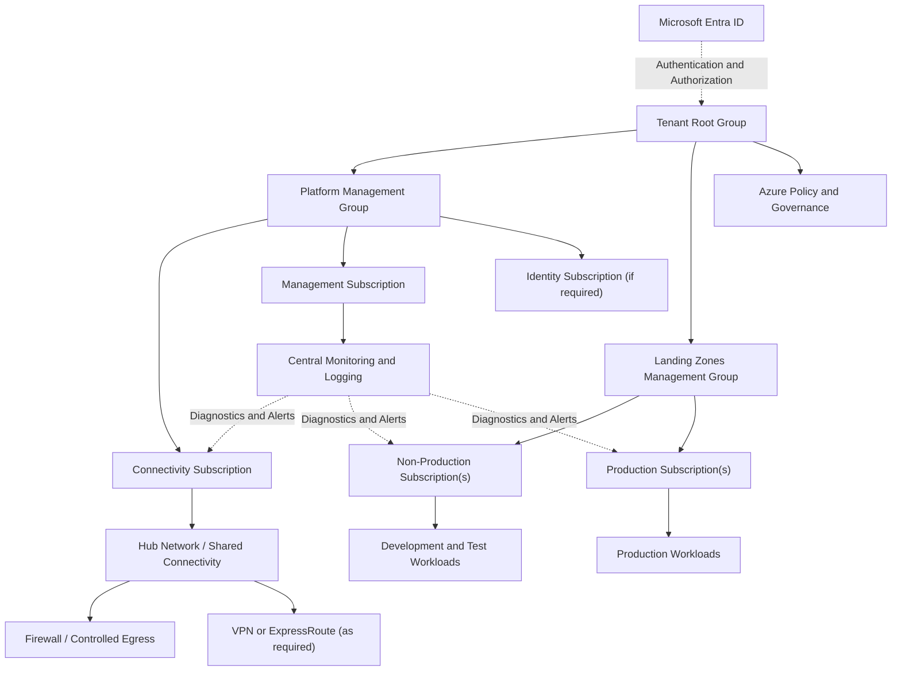

# Enterprise Azure Landing Zone — Architecture

## 1. Purpose

This document describes the target architecture for a greenfield enterprise Azure Landing Zone.

The design establishes a governed, secure, scalable foundation for hosting application workloads across development, test, and production environments.

**Implementation status:** Architecture design in progress. The diagram and design below represent the intended target state, not a deployed Azure environment.

## 2. Architecture Principles

- **Governance first:** Establish management groups, subscriptions, Azure Policy, and tagging standards.
- **Identity first:** Use Microsoft Entra ID, least-privilege RBAC, and managed identities wherever supported.
- **Network security:** Prefer private connectivity and controlled ingress and egress.
- **Infrastructure as Code:** Provision repeatable infrastructure through reusable Terraform modules.
- **Environment isolation:** Separate workloads and permissions according to environment and business risk.
- **Observability:** Centralize platform diagnostics, metrics, logs, and security events.
- **Automation:** Validate Terraform and review plans through pull-request workflows.
- **Cost management:** Apply budgets, ownership tags, and environment-specific sizing.

## 3. Logical Architecture

## 4. Management Group and Subscription Design

The management group hierarchy will separate platform services from application landing zones.

| Scope | Responsibility |
|---|---|
| Tenant Root Group | Top-level governance inheritance |
| Platform | Shared services and platform subscriptions |
| Connectivity | Shared network connectivity and routing |
| Management | Central monitoring and operational tooling |
| Landing Zones | Application workload subscriptions |
| Non-Production | Development and test workloads |
| Production | Production workloads with stricter controls |

The exact hierarchy and subscription boundaries must be validated against the organization's existing tenant, billing model, regulatory requirements, and operating model before deployment.

## 5. Networking

The target networking design may include:

- Hub-and-spoke virtual network topology.
- Non-overlapping IP address ranges.
- Azure Firewall or another approved network security control.
- VPN Gateway or ExpressRoute where hybrid connectivity is required.
- Private Endpoints and Private DNS for supported platform services.
- Network Security Groups and route tables.
- Controlled outbound connectivity and documented ingress paths.

Network ranges, regional topology, firewall SKU, and connectivity options will be decided during implementation design. No IP ranges are assumed in this document.

## 6. Security and Governance

Planned controls include:

- Microsoft Entra ID authentication and least-privilege RBAC.
- Privileged access through approved administrative processes.
- Azure Policy initiatives for mandatory governance controls.
- Standard resource naming and required tags.
- Diagnostic settings for supported resources.
- Managed identities instead of embedded credentials where supported.
- Key Vault for approved secret and key management scenarios.
- Private access for sensitive platform services where feasible.
- Security exceptions documented with an owner, justification, and expiry or review date.

Policies will be evaluated for compatibility and impact before enforcement. Policies capable of blocking deployments will be introduced through a controlled rollout.

## 7. Terraform Delivery Model

Terraform will be organized into reusable modules and environment-specific configurations.

Planned implementation sequence:

1. Confirm tenant permissions, subscription access, and provider versions.
2. Establish the Terraform state storage and access model.
3. Validate management group and subscription requirements.
4. Implement governance and policy modules.
5. Implement identity and connectivity foundations.
6. Add monitoring and diagnostic configuration.
7. Add CI validation and pull-request review.
8. Test in a non-production scope before considering production deployment.

Terraform state must not be committed to Git. Credentials and secrets must not be stored in source control.

## 8. Operational Readiness

Before production adoption, the design must define:

- Monitoring and alert ownership.
- Incident escalation and recovery procedures.
- Network and identity troubleshooting.
- Subscription ownership and cost accountability.
- Backup and disaster recovery requirements.
- Policy exception handling.
- Change approval and rollback procedures.

## 9. Open Design Decisions

The following decisions require confirmation before implementation:

- Existing tenant and management group structure.
- Subscription provisioning and ownership model.
- Required Azure regions and resilience targets.
- Hybrid connectivity requirements.
- Centralized versus workload-specific security services.
- Terraform state location and access permissions.
- Applicable regulatory and organizational policies.

## 10. Status

This document is the initial target architecture. Actual implementation, test results, diagrams, and configuration will be updated as the project progresses.

## Management-group hierarchy and implementation boundary

The intended hierarchy has only two direct children under Tenant Root:
`Platform` and `Landing Zones`.

`Platform` contains the `Management`, `Identity & Access`, `Connectivity`, and
`Security` management groups. `Landing Zones` contains `Corp`, `Online`, and
optional `Sandbox`. Subscriptions are placed under the appropriate management
groups; a subscription is not itself a management group.

The repository currently implements a subset of this target. The management
group root, basic RBAC roots, an Environment-tag audit policy, and basic hub/spoke
networking are present. A complete security platform, centralized monitoring,
Azure Firewall, gateways, Bastion, Private DNS, Private Endpoints, UDRs, and
subscription vending must not be represented as deployed or implemented until
the corresponding code and validation are added.

The architecture diagram in `architecture/landing-zone-flow.mmd` shows the
target management-group hierarchy, not a claim that every capability is deployed.
